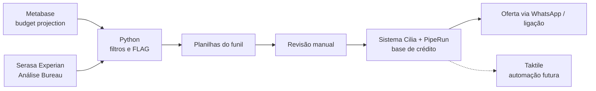

# 💳 Cilia Tecnologia — Análise de Crédito

Processo automatizado para identificar **oficinas elegíveis a uma oferta de crédito**, a partir dos orçamentos de sinistros registrados na plataforma Cilia.

📄 Metodologia completa: [CRÉDITO Cilia (Notion)](https://www.notion.so/CR-DITO-Cilia-17a2d5f40ff78048bea4d92e1a9add4d)

## 🔄 Fluxo do processo



Com o lançamento do novo produto de crédito Cilia (disponível apenas para clientes), foi criado um processo estruturado para avaliar e aprovar a liberação de crédito:

1. **Extração de dados** do Metabase e da Serasa Experian, organizados em duas planilhas:
   - **budget_projection:** dados financeiros e projeções de orçamento.
   - **Análise Bureau:** histórico de crédito, análise de risco e outros indicadores financeiros.
2. **Processamento em Python:** as duas bases são cruzadas e os filtros identificam os clientes que se enquadram nos critérios da oferta.
3. **Seleção e filtragem:** os clientes aptos são definidos por elegibilidade financeira, perfil de crédito e histórico de relacionamento, e exportados para novas planilhas Excel.
4. **Revisão manual:** especialistas conferem a **precisão dos dados** e a **elegibilidade final**, considerando fatores qualitativos que o processo automatizado não cobre.
5. **Consolidação final:** os aprovados formam a lista final, que sobe no sistema com as ofertas atualizadas para acompanhamento no **PipeRun**. Esses clientes entram automaticamente na base de crédito.
6. **Comunicação:** disparos semanais via **WhatsApp** e ligações quando necessário, para tirar dúvidas, dar suporte ou reforçar a conversão. Com a integração à **Taktile**, essa etapa passa a ser automática.

O processo direciona a oferta aos clientes certos, otimizando os esforços comerciais e minimizando riscos.

➡️ A etapa seguinte, de criação e envio das ofertas, está em **[Cilia/Taktile — Ofertas Multicanal](https://github.com/anajuliapf/cilia-ofertas-multicanal)**.

## 🧠 Lógica do funil (`funil_credito.py`)

Cada orçamento recebe uma **FLAG** que indica em que etapa do funil ele saiu ou se foi qualificado.

### Valor líquido

```
ValorLiquido = valor total do orçamento − peças fornecidas pela seguradora − franquia
```

Também é marcado se o valor líquido é ≥ R$ 20 mil.

### Filtros duros (eliminatórios)

| FLAG | Regra |
|---|---|
| `00_Oficina Teste` / `00_Seguradora Teste` | Oficinas e seguradoras de teste ou demonstração |
| `01_Orçamento não Segurado` | Processo que não é de Segurado nem de Terceiro |
| `02_ValorInadequado` | Valor total ou líquido ≤ 0 |
| `03_Cancelado ou II` | Conclusões como perda total, indenização integral, vistoria cancelada etc. |
| `04_Orçamento Concluído` | Já possui NF de peças ou serviços, ou está em supervisão/verificação |
| `05_Não autorizado pela seguradora` | Orçamento ainda na versão 1 |
| `06_VerificacaoLiberty` | Auto vistoria |

### Filtros leves (de perfil)

| FLAG | Regra |
|---|---|
| `07_Veículo Indesejado` | Fora de Passeio, Motos, Furgão/Vans e Pick-ups |
| `08_FabricanteProblematica` | Montadora fora da lista aceita |
| `09_SeguradoraMenor` | Seguradora fora da lista de parceiras principais |
| `10_StatusVolatil` | Orçamento ainda não analisado |

### Qualificados

| FLAG | Regra |
|---|---|
| `11_Mais de 1 Sócio_Adm` | Oficina com 2+ sócios (ou sem informação) |
| `99_OK` | Passou por todos os filtros |

### Score de crédito

O funil é agregado por oficina (CNPJ) e cruzado com o **score de bureau**, classificado em faixas:

| Score | Faixa |
|---|---|
| < 300 ou sem score | 🔴 Vermelho |
| 300–399 | 🟠 Laranja |
| 400–499 | 🟡 Amarelo |
| 500–599 | 🔵 Azul |
| ≥ 600 | 🟢 Verde |

### Saídas

| Arquivo | Conteúdo |
|---|---|
| `sumariofunil.xlsx` | Funil por FLAG e oficina, com score |
| `funilsegttl.xlsx` | Funil por FLAG, seguradora e oficina |
| `funilokZurichSura.xlsx` | Recorte das seguradoras priorizadas (Zurich, SURA, Allianz) |
| `linhasokttl.xlsx` / `linhasokZurichSuraAll.xlsx` | Orçamentos qualificados |
| `contador.xlsx` | Quantidade e valor líquido por oficina nas seguradoras priorizadas |

## ▶️ Como executar

```bash
pip install pandas openpyxl ipython
# coloque as bases em data/ (não versionadas)
python funil_credito.py
```

> ⚠️ As bases de dados são confidenciais e **não fazem parte deste repositório**.

## 🧰 Ferramentas

Python · pandas · Jupyter · Metabase · Excel · Taktile
